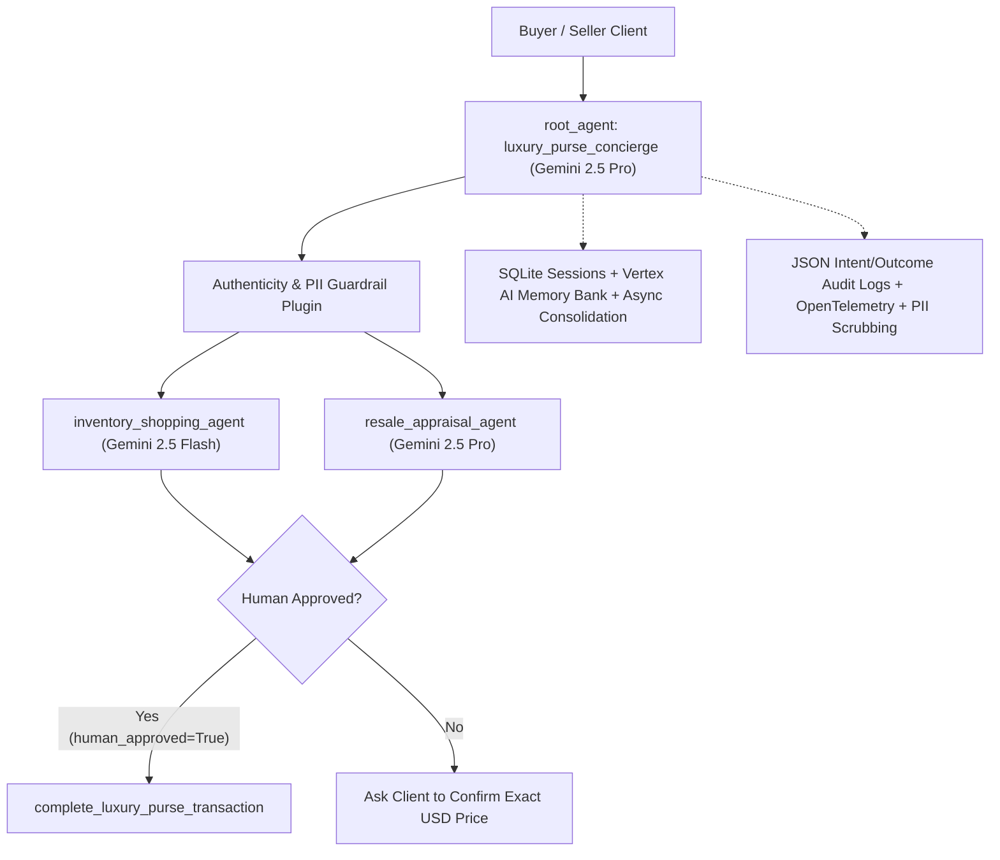

# Maison Luxe — Buying & Selling Luxury Purses Concierge Agent (`google-adk`)

A clean, production-grade **Google Agent Development Kit (`google-adk`)** multi-agent concierge for **buying and selling authentic designer luxury handbags** (Hermès, Chanel, Dior, Louis Vuitton).

---

## 1. Problem & Solution

* **Problem:** Buying pre-owned luxury handbags safely—or pricing a bag accurately to sell based on condition grade and authenticity cards—requires slow manual lookups, valuation expertise, and strict fraud/counterfeit protection.
* **Solution (`luxury_purse_agent`):** A streamlined multi-agent ADK concierge that splits the workflow across specialized Gemini models with strict safety guardrails and Human-in-the-Loop confirmation:
  1. **`inventory_shopping_agent` (`gemini-2.5-flash`)** — Instant catalog search for authenticated bags under the shopper's budget (`search_luxury_purse_inventory`).
  2. **`resale_appraisal_agent` (`gemini-2.5-pro`)** — Evaluates seller payouts by brand, model, condition tier (`pristine` / `excellent` / `good`), and authenticity card (`estimate_purse_resale_value`).
  3. **`luxury_purse_concierge` (`root_agent`, `gemini-2.5-pro`)** — Blocks counterfeit requests via guardrails and requires **explicit Human-in-the-Loop approval (`human_approved=True`)** before executing high-value buy/sell transactions (`complete_luxury_purse_transaction`).

---

## 2. Architecture Diagram



---

## 3. Quickstart & ADK CLI Usage

```bash
python3 -m venv .venv
source .venv/bin/activate
pip install -r requirements.txt
cp .env.example .env

# Launch interactive ADK Web UI:
adk web

# Or run from terminal:
adk run luxury_purse_agent

# Deploy to Google Cloud Run via ADK CLI:
adk deploy cloud_run --project=$GOOGLE_CLOUD_PROJECT --region=us-central1 ./luxury_purse_agent
```

### Run Golden Evaluation & Unit Test Suite
```bash
pytest -v
# Or zero-dependency Python standard library test runner:
python3 -m unittest discover -s tests -v
```
