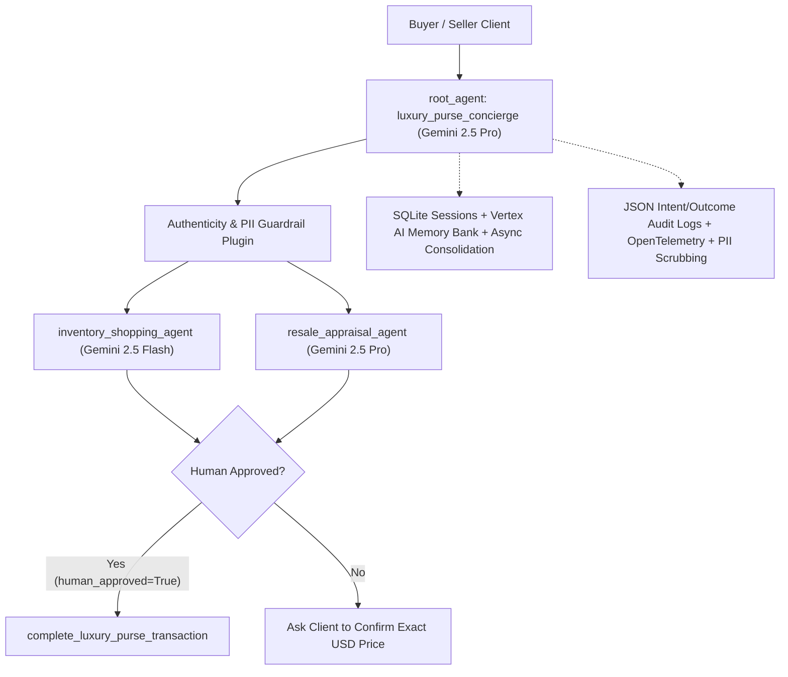

# Maison Luxe — Buying & Selling Luxury Purses Concierge Agent (`google-adk`)

A flat, self-contained **Google Agent Development Kit (`google-adk`)** multi-agent concierge for **buying and selling authentic designer luxury handbags** (Hermès, Chanel, Dior, Louis Vuitton).

---

## 1. Problem & Solution

* **Problem:** Buying pre-owned luxury handbags safely—or pricing a bag accurately to sell based on condition grade and authenticity cards—requires slow manual lookups, valuation expertise, and strict fraud/counterfeit protection.
* **Solution (`luxury_purse_concierge`):** A multi-agent ADK concierge in `agent.py` that coordinates specialist sub-agents with strict safety guardrails and Human-in-the-Loop approval:
  1. **`inventory_shopping_agent` (`gemini-2.5-flash`)** — Fast catalog search for authenticated bags within the buyer's budget (`search_luxury_purse_inventory` in `tools.py`).
  2. **`resale_appraisal_agent` (`gemini-2.5-pro`)** — Evaluates seller payout quotes by brand, model, condition tier (`pristine` / `excellent` / `good`), and authenticity card (`estimate_purse_resale_value` in `tools.py`).
  3. **`luxury_purse_concierge` (`root_agent`, `gemini-2.5-pro`)** — Enforces counterfeit guardrails (`guardrail_before_model`) and requires **explicit Human-in-the-Loop confirmation (`human_approved=True`)** before executing high-value buy/sell orders (`complete_luxury_purse_transaction` in `tools.py`).

---

## 2. Architecture Overview



---

## 3. Repository Files (Flat Root Layout)

* `agent.py` — Multi-agent ADK definition (`root_agent`, `concierge_workflow`, Flash/Pro routing, guardrails, & Human-in-the-Loop callbacks)
* `__init__.py` — Exposes `root_agent` for ADK CLI discovery
* `tools.py` — Luxury handbag shopping, appraisal, & HITL transaction tools with guided error recovery
* `schemas.py` — Strict Pydantic input/output JSON schemas
* `memory.py` — SQLite `DatabaseSessionService`, `VertexAiMemoryBankService`, history compaction, & async consolidation
* `observability.py` — Structured JSON logging, `agent_intent`/`agent_outcome` audit trail, OpenTelemetry spans, PII scrubbing, & Secret Manager integration
* `golden_dataset.json` — Golden evaluation dataset scenarios
* `test_luxury_agent.py` — Automated evaluation & unit test suite
* `main.tf` — Terraform Infrastructure-as-Code (Vertex AI, Secret Manager, Cloud DLP, Cloud Run)
* `Dockerfile` & `requirements.txt` — Containerization & Python dependencies

---

## 4. Quickstart & ADK CLI Usage

```bash
python3 -m venv .venv
source .venv/bin/activate
pip install -r requirements.txt

# Set your GCP project (secrets load automatically from Google Cloud Secret Manager):
export GOOGLE_GENAI_USE_VERTEXAI=TRUE
export GOOGLE_CLOUD_PROJECT=your-gcp-project-id
export GOOGLE_CLOUD_LOCATION=us-central1

# Launch interactive ADK Web UI:
adk web

# Or run from terminal CLI:
adk run .

# Deploy to Google Cloud Run via ADK CLI:
adk deploy cloud_run --project=$GOOGLE_CLOUD_PROJECT --region=us-central1 .

# Run automated Golden Evaluation & Unit Test Suite:
pytest -v
python3 -m unittest discover -v
```
